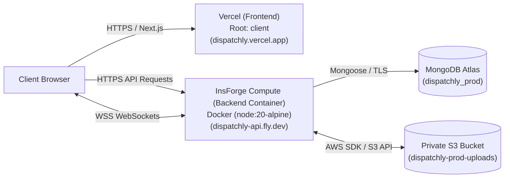

# Dispatchly Production Deployment Guide

This guide details the step-by-step production deployment for **Dispatchly**:
- **Frontend:** Next.js 14 App Router on **Vercel**
- **Backend:** Node.js Express + Socket.IO Docker container on **InsForge Compute**
- **Database:** **MongoDB Atlas**
- **File Storage:** **AWS S3** (or S3-compatible: Cloudflare R2 / MinIO)

---

## Architecture Overview



---

## Step 1: Provision MongoDB Atlas Database

1. **Log in to MongoDB Atlas:** Go to [cloud.mongodb.com](https://cloud.mongodb.com) and navigate to your project.
2. **Dedicated Database:** Use a clean, dedicated production database name (e.g. `dispatchly_prod`), separate from any development or staging collections.
3. **Least-Privilege Database User:**
   - In Atlas, navigate to **Security &rarr; Database Access**.
   - Create a dedicated user (e.g. `dispatchly_svc`).
   - Grant **Built-in Role: `readWrite`** scoped specifically to the `dispatchly_prod` database only.
   - Generate a strong, high-entropy password (alphanumeric, 24+ characters).
4. **Network Access / IP Whitelisting:**
   - Navigate to **Security &rarr; Network Access**.
   - Container cloud environments (such as InsForge Compute / Fly.io) draw outbound connections from a pool of dynamic IP addresses.
   - If static egress IPs or VPC peering are not configured on your Compute plan, add `0.0.0.0/0` (Allow Access from Anywhere).
   - **Security Requirement:** If `0.0.0.0/0` is used, you **MUST** ensure the database user password is strong and TLS encryption is enforced by the `mongodb+srv://` protocol.
5. **Connection String:**
   Copy the SRV URI:
   ```env
   MONGODB_URI=mongodb+srv://dispatchly_svc:<STRONG_PASSWORD>@<cluster-subdomain>.mongodb.net/dispatchly_prod?retryWrites=true&w=majority
   ```

---

## Step 2: Configure Cloud Storage (AWS S3 or Cloudflare R2)

Because container file systems on InsForge Compute are ephemeral (disks reset whenever a new version is deployed), `STORAGE_DRIVER=s3` is required in production.

1. **Create S3 Bucket:**
   - Name: `dispatchly-prod-uploads` (or your chosen unique name).
   - Enable **Block all public access** (all uploads and evidence remain strictly private).
   - Enable Server-Side Encryption (SSE-S3 or KMS).
2. **IAM Policy & User:**
   Create an IAM policy with least-privilege permissions:
   ```json
   {
     "Version": "2012-10-17",
     "Statement": [
       {
         "Effect": "Allow",
         "Action": [
           "s3:PutObject",
           "s3:GetObject",
           "s3:DeleteObject"
         ],
         "Resource": "arn:aws:s3:::dispatchly-prod-uploads/*"
       }
     ]
   }
   ```
3. Create an IAM User with Programmatic Access, attach this policy, and save `AWS_ACCESS_KEY_ID` and `AWS_SECRET_ACCESS_KEY`.

---

## Step 3: Deploy Backend to InsForge Compute

InsForge Compute hosts containerized Docker services running on isolated Linux microVMs. The Dockerfile at `server/Dockerfile` builds a production container using `node:20-alpine`, runs as non-root user `node`, and listens on `PORT 5000`.

### 1. Authenticate & Link with InsForge CLI
Run the following from your terminal in the repository root:
```bash
# 1. Log in to InsForge
npx @insforge/cli login

# 2. Link repository to your InsForge project
npx @insforge/cli link
```

### 2. Prepare Production Backend Environment File
Create a local file (e.g., `server/.env.production` — do NOT commit this file to Git):
```env
PORT=5000
NODE_ENV=production
CLIENT_URL=https://your-app-name.vercel.app
ALLOW_VERCEL_PREVIEWS=true
DEMO_MODE=false

MONGODB_URI=mongodb+srv://dispatchly_svc:<PASSWORD>@<cluster>.mongodb.net/dispatchly_prod?retryWrites=true&w=majority

# Generate using: openssl rand -base64 48
JWT_ACCESS_SECRET=<SECURE_RANDOM_SECRET_KEY_MIN_32_CHARS>
JWT_REFRESH_SECRET=<DIFFERENT_SECURE_RANDOM_SECRET_KEY_MIN_32_CHARS>
JWT_ACCESS_EXPIRY=15m
JWT_REFRESH_EXPIRY=7d

STORAGE_DRIVER=s3
AWS_ACCESS_KEY_ID=<AKIA...>
AWS_SECRET_ACCESS_KEY=<SECRET...>
AWS_REGION=us-east-1
AWS_S3_BUCKET=dispatchly-prod-uploads
```

### 3. Deploy the Compute Container
Deploy the backend directory using the verified `@insforge/cli compute deploy` command:
```bash
npx @insforge/cli compute deploy server \
  --name dispatchly-api \
  --port 5000 \
  --always-on \
  --cpu shared-1x \
  --memory 512 \
  --env-file server/.env.production
```

> **Why `--always-on`?**
> The backend runs background sweepers (`expirySweeper`, `slaSweeper`, `paymentReconciliationSweeper`, `autoVerificationSweeper`) and manages persistent Socket.IO connections. Flag `--always-on` prevents the container from scaling to zero when web traffic is idle.

### 4. Verify Health Check
Upon completion, the CLI returns your live service URL (e.g. `https://dispatchly-api.fly.dev` or `https://dispatchly-api.insforge.app`). Verify the deployment:
```bash
curl -i https://<YOUR_COMPUTE_URL>/api/health
```
Expected response (`HTTP 200`):
```json
{
  "status": "healthy",
  "uptimeSeconds": 12,
  "services": {
    "database": "connected",
    "dispatchSweeper": "running",
    "slaSweeper": "running",
    "paymentSweeper": "running",
    "verificationSweeper": "running"
  }
}
```

---

## Step 4: Deploy Frontend to Vercel

1. **Push your code to GitHub:** Ensure all latest commits are pushed to your remote repository.
2. **Import Project on Vercel:**
   - Go to [vercel.com/new](https://vercel.com/new) and select your `dispatchly` repository.
   - **Framework Preset:** Next.js
   - **Root Directory:** Click "Edit" and choose **`client`**.
3. **Configure Environment Variables:**
   Add the following environment variables in the Vercel project settings:
   | Variable | Value | Notes |
   | :--- | :--- | :--- |
   | `NEXT_PUBLIC_API_URL` | `https://<YOUR_COMPUTE_URL>/api` | **Must include `/api` suffix** |
   | `NEXT_PUBLIC_SOCKET_URL` | `https://<YOUR_COMPUTE_URL>` | **Direct Compute URL, NO `/api` suffix** |
   | `NEXT_PUBLIC_DEMO_MODE` | `false` | Disables demo test buttons in production |
4. **Deploy:** Click **Deploy**. Vercel will run `next build` and assign your production domain (e.g. `https://dispatchly.vercel.app`).

> **Note on WebSockets:** Vercel serverless edge functions do not proxy persistent WebSocket streams. Socket.IO in `client/src/lib/socket.js` is engineered to connect **directly** to `NEXT_PUBLIC_SOCKET_URL`, bypassing Vercel and connecting straight to your InsForge Compute container.

---

## Step 5: Finalize CORS on Backend

Now that your official Vercel URL is known (e.g., `https://dispatchly.vercel.app`):
1. Update `CLIENT_URL` in `server/.env.production`:
   ```env
   CLIENT_URL=https://dispatchly.vercel.app
   ```
2. Update the compute service configuration:
   ```bash
   npx @insforge/cli compute deploy server \
     --name dispatchly-api \
     --port 5000 \
     --always-on \
     --env-file server/.env.production
   ```

---

## Step 6: Bootstrap the Initial Administrator Safely

Never run seed scripts (`seed.js`) on a production database because they delete all collections and create mock demo records. Instead, use the isolated, zero-risk `create:admin` script:

```bash
# Run locally pointing to your production database OR execute via container runner
cd server
ADMIN_EMAIL="admin@yourdomain.com" \
ADMIN_PASSWORD="YourStrongAdminPassword123!" \
ADMIN_NAME="Chief Operations Officer" \
node src/scripts/createAdmin.js
```
The script:
- Verifies database connectivity.
- Confirms that **no admin account exists yet** (if one exists, it safely aborts).
- Creates the single administrative account with hashed credentials.

---

## Step 7: Post-Deployment Smoke Test Checklist

Execute these end-to-end tests against your live production Vercel URL:

- [ ] **1. Health Probes:** `GET https://<COMPUTE_URL>/api/health` returns `200 OK` with database connected.
- [ ] **2. Administrator Sign-In:**
  - Visit `https://<VERCEL_URL>/login`.
  - Enter your bootstrapped admin email and password.
  - Verify redirect to `/admin/dashboard`.
  - Confirm the Quick Demo selector bar is hidden when `NEXT_PUBLIC_DEMO_MODE=false`.
- [ ] **3. Service Catalogue & Settings:**
  - Visit `/admin/settings` and verify platform defaults ($1.50 ticket fee, 60s offer expiry, dispatch weights).
  - Visit `/admin/services` and create your production services (or seed initial catalogue items).
- [ ] **4. Technician Registration & Cloud Storage Upload:**
  - In an incognito window, visit `/register` and register as a technician.
  - Complete the onboarding wizard at `/technician/profile`.
  - Upload a valid PDF or JPG document at Stage 4.
  - Confirm the document is uploaded to your private S3 bucket and appears in the technician's list.
- [ ] **5. Verification Review:**
  - Log back in as Admin and visit `/admin/technicians`.
  - Under "Pending Approval", open the applicant profile and click **Download / Inspect** (verifies backend authenticated streaming from S3).
  - Click **Approve Technician**.
- [ ] **6. Booking & Real-Time Socket Dispatch:**
  - In a separate window, register/login as a Customer.
  - Go to `/book`, choose location on the Leaflet map, and confirm a booking.
  - Observe the technician receiving a real-time dispatch offer notification via Socket.IO.
  - Accept the offer and verify live tracking transition on the customer dashboard.
- [ ] **7. Completion, Mock Payment & Review:**
  - Progress the job to `in_progress`, then click `Complete Job` and upload photo evidence.
  - As Customer, verify the job, process mock payment, and leave a review.
  - Verify financial ledger updates under `/admin/payments` and CSAT rating updates on `/admin/dashboard`.

---

## Step 8: Operational Maintenance & Rollbacks

### How to Roll Back a Backend Release
If an issue is detected on the backend container:
1. View compute service status:
   ```bash
   npx @insforge/cli compute list
   npx @insforge/cli compute get dispatchly-api
   ```
2. Re-deploy the previously verified Git commit or Docker image:
   ```bash
   git checkout <PREVIOUS_HEALTHY_COMMIT>
   npx @insforge/cli compute deploy server --name dispatchly-api --port 5000 --always-on --env-file server/.env.production
   ```

### How to Rotate JWT Secrets
If JWT access or refresh secrets are compromised:
1. Generate new secrets: `openssl rand -base64 48`.
2. Update `JWT_ACCESS_SECRET` and `JWT_REFRESH_SECRET` in `server/.env.production`.
3. Redeploy the compute service.
4. **Invalidate Active User Sessions:** If immediate revocation of all currently issued tokens is required, run the following MongoDB query to increment every user's `tokenVersion`:
   ```javascript
   db.users.updateMany({}, { $inc: { tokenVersion: 1 } });
   ```
   All existing JWT tokens will be rejected immediately by the `authenticateToken` middleware, forcing all users to sign in again with fresh credentials.

---

## Known Limitations in Production

1. **Single Instance Architecture:**
   - Dispatchly's background sweepers (`expirySweeper`, `slaSweeper`, `autoVerificationSweeper`, `paymentReconciliationSweeper`) run in-process using Node.js intervals.
   - Socket.IO utilizes the default in-memory adapter.
   - **Scaling Rule:** The backend container should run with **1 replica**. Running multiple container replicas simultaneously requires:
     - Adding `@socket.io/redis-adapter` with a Redis instance (Upstash or Redis Cloud) for cross-container message routing.
     - Adding distributed locks (e.g. `redlock` or MongoDB lease documents) to prevent sweepers on multiple instances from firing duplicate offers or reconciliations.
2. **Mock Payment Gateway:**
   - The current payment implementation simulates credit card authorizations, settlements, and platform fee deductions using realistic transaction delays without charging live cards. To integrate live Stripe payments, configure Stripe Webhooks and replace `mockPaymentGateway.js` with `stripe.paymentIntents.create`.
3. **Map Basemap & OSRM Routing Traffic (Demo vs Production):**
   - **Map Tiles (`NEXT_PUBLIC_MAP_STYLE_URL` & `NEXT_PUBLIC_MAP_STYLE_URL_FALLBACK`):** Defaults to the public OpenFreeMap instance (`https://tiles.openfreemap.org/styles/positron`). OpenFreeMap is donation-funded with **no SLA**. Before serving real customers, choose a paid provider (MapTiler, Mapbox, or Google Maps) — switching is purely a config change via `NEXT_PUBLIC_MAP_STYLE_URL` with zero code changes. You may optionally set `NEXT_PUBLIC_MAP_STYLE_URL_FALLBACK` as an automatic fallback style if the primary style fails after one retry.
   - **Routing (`OSRM_BASE_URL`):** The public OSRM server (`https://router.project-osrm.org`) is **demo-only** and rate-limited. Production deployments must point `OSRM_BASE_URL` to a hosted routing service (or private OSRM cluster).
4. **Demo-Only Environment Flags (`DEMO_MODE` & `DEMO_FRESH_LOCATIONS`):**
   - Both `DEMO_MODE` and `DEMO_FRESH_LOCATIONS` default to `false` and must **never** be enabled in production.
   - When `DEMO_FRESH_LOCATIONS=true` (demo/staging only), the eligibility filter skips only the location staleness check for online, approved technicians while keeping every other eligibility rule intact.
5. **Compute Resource Limits:**
   - Ensure your InsForge account subscription tier has sufficient credits and memory allocation for the container service (512MB RAM minimum is recommended). Check the InsForge dashboard for compute utilization and bandwidth metrics.
6. **Platform Fee Configuration (`platformFeePerTicket`):**
   - `PlatformSettings.platformFeePerTicket` defaults to `50` INR as a **placeholder** pending the operations team's final fee decision. Adjust it anytime from `/admin/settings`.
