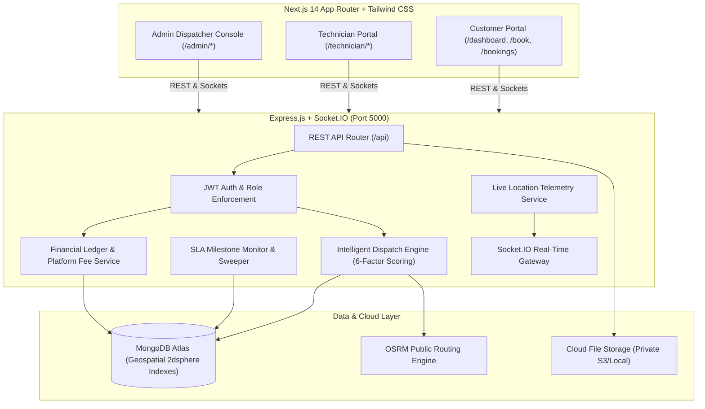
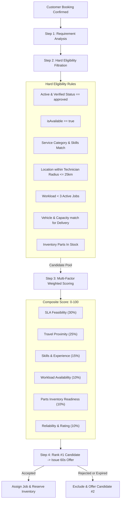

# Dispatchly &mdash; Last-Mile Dynamic Technician Dispatcher

> An autonomous on-demand marketplace connecting customers with verified independent technicians across **Plumbing**, **HVAC**, and **Urgent Courier Delivery** with sub-500ms multi-factor dispatch ranking, strict SLA milestone tracking, live GPS telemetry, parts inventory locking, and financial ledger settlement.

---

## 1. System Architecture



---

## 2. Key Modules & Technical Capabilities

- **Intelligent Dispatch Engine**: Replaces crude "broadcast to everyone" models with candidate eligibility filtration (category, skills, capacity, geo-coverage, active job ceiling) and normalized 6-factor weighted ranking (SLA feasibility 30%, travel time 25%, skills 15%, workload 10%, inventory 10%, reliability 10%).
- **Sequential Offer Fallback**: Offers tickets to the top-ranked candidate for a configurable window (default 60s); upon reject or expiration, the background sweeper reassigns to candidate #2.
- **SLA Milestone Tracking**: Proactively tracks Response, Arrival, and Completion milestones per priority (Urgent vs Normal); warns dispatchers at 80% elapsed time and flags breaches.
- **Parts Inventory Reservation**: Atomic reservation and deduction of technician vehicle stock to prevent double-allocation across jobs.
- **Quotation Approval Gate**: Standard services use fixed prices; complex repairs require technician on-site quote submission with mandatory customer approval before work commences.
- **Financial Ledger & Platform Fee**: Captures payment authorizations upon job verification, records $1.50 ticket fees, and automates technician payouts.

---

## 3. Getting Started & Local Setup

### Prerequisites
- Node.js >= 18.0.0
- MongoDB Atlas cluster URI (or local MongoDB 6+)
- npm >= 9.0.0

### Installation
Clone repository and install monorepo dependencies:
```bash
git clone https://github.com/your-org/dispatchly.git
cd dispatchly

# Install root, backend, and frontend packages
npm install
npm run install:all
```

### Environment Configuration

1. **Backend Environment** (`server/.env`):
```env
PORT=5000
NODE_ENV=development
CLIENT_URL=http://localhost:3000
MONGODB_URI=mongodb+srv://<user>:<password>@cluster.mongodb.net/dispatchly?retryWrites=true&w=majority
JWT_ACCESS_SECRET=super_secret_access_key_12345
JWT_REFRESH_SECRET=super_secret_refresh_key_67890
JWT_ACCESS_EXPIRY=15m
JWT_REFRESH_EXPIRY=7d
STORAGE_DRIVER=local
```

2. **Frontend Environment** (`client/.env.local`):
```env
NEXT_PUBLIC_API_URL=http://localhost:5000/api
NEXT_PUBLIC_SOCKET_URL=http://localhost:5000
```

---

## 4. Operational Scripts & NPM Commands

| Command | Action |
| :--- | :--- |
| `npm run dev:all` | Launches both Next.js frontend (3000) and Express server (5000) concurrently |
| `npm run dev:server` | Starts Express backend in nodemon live-reload mode |
| `npm run dev:client` | Starts Next.js 14 client dev server |
| `npm run seed:reset` | Wipes and seeds 30-day realistic historical data (plumbing, HVAC, delivery, payments, reviews) |
| `npm run test:server` | Executes full Jest backend test suite (84 integration tests) |
| `npm run test:e2e` | Executes end-to-end marketplace flow test suite |
| `npm run benchmark` | Tests API response times against the PRD 500ms target |
| `npm run build --prefix client` | Compiles production Next.js 14 client with route validation |

---

## 5. Seed Credentials (One-Click Ready)

All demo accounts use password **`password123`**:

| Role | Email | Profile Focus |
| :--- | :--- | :--- |
| **Dispatcher Admin** | `admin@dispatchly.com` | Full operations control, KPI analytics, dispute resolution |
| **Customer (Alice)** | `customer@dispatchly.com` | Booking creation, live technician tracking, reviews |
| **Customer (Bob)** | `bob.customer@dispatchly.com` | Booking creation & quotation approvals |
| **Customer (Mike)** | `mike.customer@dispatchly.com` | Delivery bookings & dispute escalation testing |
| **Technician (David)** | `plumber@dispatchly.com` | Plumbing specialist (pipe soldering, leak detection) |
| **Technician (Sam)** | `sam.plumber@dispatchly.com` | Pending approval plumber (verification review testing) |
| **Technician (Marcus)** | `hvac@dispatchly.com` | HVAC certified technician (AC servicing, gas refill) |
| **Technician (Carlos)** | `courier@dispatchly.com` | Delivery partner (car payload up to 25 kg) |

---

## 6. Dispatch Algorithm Breakdown



---

## 7. Pending Stakeholder Decisions (Governance Matrix)

| # | Item | Current Implementation | Alternatives Pending Decision |
| :---: | :--- | :--- | :--- |
| **1** | **Platform Fee Payer** | Deducted from Technician payout ($1.50 per completed job) | Customer surcharge vs 50/50 split ($0.75 / $0.75) |
| **2** | **Cancellation Policy** | Free cancellation before technician travel commences | Flat $15 travel fee if quotation rejected on-site |
| **3** | **Customer Auto-Acceptance** | 24-hour verification window before auto-settlement | 48-hour window |
| **4** | **SLA Warning Threshold** | Warning trigger at 80% elapsed milestone time | 85% elapsed time |
| **5** | **Payout Cadence** | Instant automated payout record upon verification | Weekly batch direct-deposit transfer |
| **6** | **Dispute Escalation** | Mandatory dispatcher mediation via `/admin/disputes` | Automated 7-day 50% split refund |

---

## 8. Known Limitations & Architecture Notes

1. **Single Backend Instance**: Designed for high performance on a single container instance; horizontal scaling with multi-pod clusters requires configuring Redis adapter for Socket.IO.
2. **Mock Payment Provider**: Simulates payment authorization, capture, and refund lifecycles without requiring external Stripe keys during local evaluation.
3. **OSRM Public Routing**: Distances and travel durations utilize OSRM driving profiles; does not account for temporary live traffic bottlenecks.
